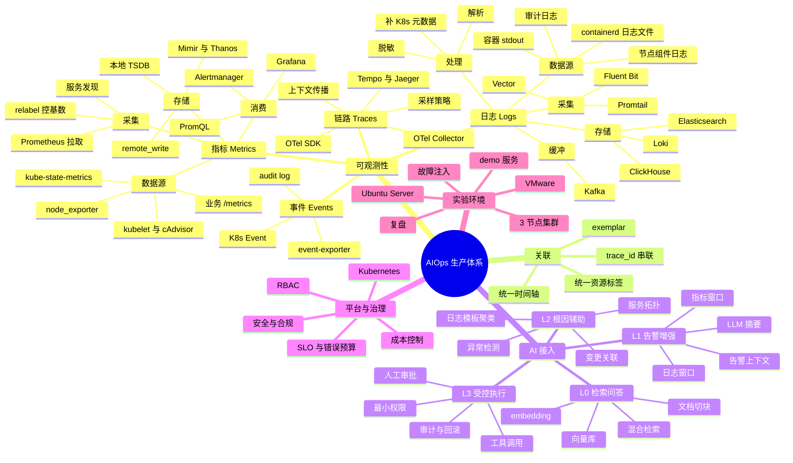

# AIOps 全局思维导图

先看地图，再看细节。下面这张图把「可观测性数据」和「AI 接入」放在同一棵树里：AI 不是独立的系统，它是数据消费端的一层。

## Mermaid 思维导图

在 VS Code 里安装 `Markdown Preview Mermaid Support` 插件即可预览；GitHub 也原生支持。



## 导入 XMind

同目录下的 `aiops-mindmap.opml` 可以直接用 XMind 的「文件 → 导入 → OPML」打开。下面也附了纯文本大纲，方便粘贴到其他工具。

## 文字版大纲（可直接粘贴进 XMind）

```text
AIOps 生产体系
  可观测性
    指标 Metrics
      数据源：node_exporter、kubelet/cAdvisor、kube-state-metrics、业务 /metrics
      采集：Prometheus 拉取、服务发现、relabel 控基数
      存储：本地 TSDB、remote_write、Mimir/Thanos/VictoriaMetrics
      消费：PromQL、Alertmanager、Grafana
    日志 Logs
      数据源：容器 stdout、containerd 日志文件、节点组件日志、审计日志
      采集：Fluent Bit、Vector、Promtail
      缓冲：Kafka
      处理：解析、脱敏、补 K8s 元数据
      存储：Loki、Elasticsearch、ClickHouse
    链路 Traces
      OTel SDK、上下文传播、OTel Collector、采样、Tempo/Jaeger
    事件 Events
      K8s Event、event-exporter、audit log
  关联
    统一时间轴、统一资源标签、trace_id 串联、exemplar
  AI 接入
    L0 检索问答：文档切块、embedding、向量库、混合检索
    L1 告警增强：告警上下文、指标窗口、日志窗口、LLM 摘要
    L2 根因辅助：服务拓扑、异常检测、日志模板聚类、变更关联
    L3 受控执行：工具调用、最小权限、人工审批、审计与回滚
  平台与治理
    Kubernetes、RBAC、SLO 与错误预算、成本控制、安全与合规
  实验环境
    VMware、Ubuntu Server、3 节点集群、demo 服务、故障注入、复盘
```

## 怎么用这张图

- **横向看**是四条数据流（指标、日志、链路、事件），它们最终在「关联」这一层汇合。
- **纵向看**是每一层的职责：数据源 → 采集 → 传输 → 存储 → 消费。
- **AI 接入**挂在最右侧，说明它依赖前面的数据质量；数据链路不成立，AI 只能编故事。
- **平台与治理**是横切面：权限、成本、SLO 会同时约束每一条数据流。

## 三个必须先记住的判断

1. **采集和存储是分离的。** 采集端只负责「拿到并送出」，存储端决定「留多久、查多快、花多少钱」。
2. **元数据决定可用性。** 日志没有 namespace/pod 标签，就不知道是谁写的；指标标签基数失控，Prometheus 会先于业务挂掉。
3. **AI 只改变消费方式，不改变数据流。** 它读的还是 Prometheus、Loki、Tempo 里的数据，只是把「人查」变成「模型带着证据总结」。
