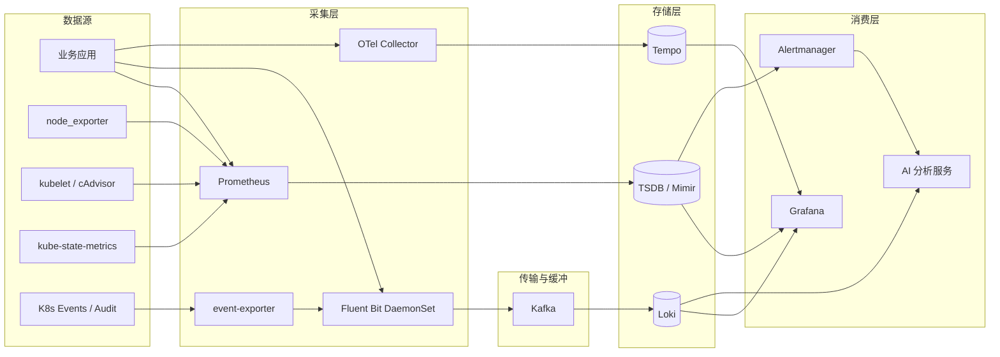
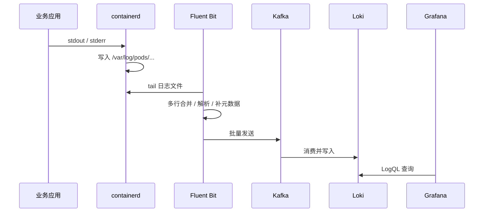
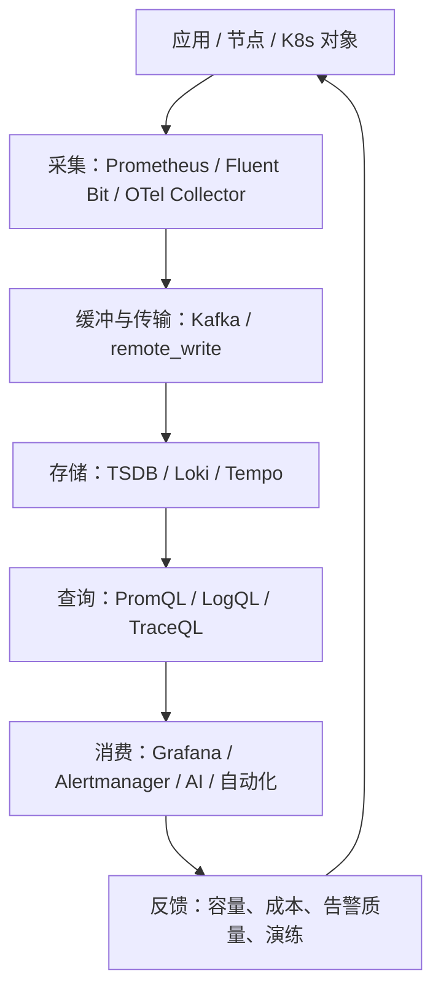

# 可观测性数据流原理

这一章回答四个问题：

1. 数据从哪里产生？
2. 谁来采、怎么采？
3. 存在哪里、为什么这么存？
4. 查询和告警怎么用这些数据？

所有链路都可以套进同一个模型：

```text
数据源 → 采集 Agent → 传输/缓冲 → 存储 → 查询/告警 → 消费者（人 / AI / 自动化）
```

不同链路的差别只在「数据长什么样」和「存储怎么索引」。



---

## 1. 指标（Metrics）：最便宜、最适合告警

### 1.1 为什么 Prometheus 用「拉」而不是「推」

Prometheus 每隔一个固定间隔，主动去目标的 `/metrics` 端点抓取数据。目标地址不是写死的，而是通过 Kubernetes 服务发现自动得到。

拉模型带来三个好处：

- **目标是否存活是明确的。** Prometheus 自己会生成 `up{job="..."}` 指标，抓不到就是 0。
- **配置集中。** 应用只需要暴露一个 HTTP 端点，不需要知道监控后端在哪。
- **天然限流。** 抓取频率由服务端决定，应用不会因为监控后端慢而堆积。

例外情况：

- 生命周期很短的批处理任务，来不及被拉到，用 **Pushgateway**。
- 跨集群、跨网络时，可以在边缘放一个 Prometheus agent，再用 `remote_write` 把数据送回中心。

### 1.2 Kubernetes 里的指标从哪里来

| 来源 | 典型指标 | 回答什么问题 |
|---|---|---|
| `node_exporter` | CPU、内存、磁盘、网络、load | 节点本身是否健康 |
| `kubelet`（含 cAdvisor） | 容器 CPU、内存、网络、文件系统 | 哪个容器在吃资源 |
| `kube-state-metrics` | Deployment 副本数、Pod 阶段、重启次数、Job 状态 | 「期望状态」和「实际状态」差在哪 |
| 业务 `/metrics` | 请求量、错误率、延迟、队列长度 | 业务是否正常 |
| `blackbox_exporter` | 探针成功率、响应时间 | 从外部看服务是否可用 |

一个常见的误解：`kube-state-metrics` 不采集容器资源使用量，它只把 K8s 对象的状态翻译成指标。资源使用量来自 kubelet 的 cAdvisor。

### 1.3 服务发现与 relabel：控制基数的第一道闸门

Prometheus 通过 `kubernetes_sd_configs` 发现目标，支持 `node`、`pod`、`service`、`endpoints`、`ingress` 等角色。发现之后要经过两层 relabel：

- `relabel_configs`：决定「抓不抓这个目标」，以及目标上带哪些标签。
- `metric_relabel_configs`：决定「抓到的指标存不存」，可以丢掉高基数标签或整条指标。

**基数（cardinality）** 是指标的生命线。一条时间序列由「指标名 + 一组标签」唯一确定，序列总数大致等于所有标签值的组合数。把 `pod`、`url`、`user_id`、`trace_id` 这类高基数值放进标签，序列数会迅速膨胀，Prometheus 的内存和查询延迟会先于业务崩溃。

### 1.4 存储：本地 TSDB 与长期存储

- Prometheus 本地 TSDB 按 2 小时一个 block 落盘，用 WAL 保证崩溃恢复。
- 保留期由 `--storage.tsdb.retention.time` 控制，本地盘通常只留几天到几周。
- `remote_write` 把数据复制到长期存储：Thanos、Mimir、VictoriaMetrics 等。
- 高可用通常是两个 Prometheus 抓同样的目标，查询时去重；或者用 Thanos/Mimir 的集群模式。

### 1.5 PromQL 与告警

几个必须掌握的语义：

- `rate(http_requests_total[5m])`：计数器每秒增量，计数器重置会自动处理。
- `histogram_quantile(0.95, ...)`：从直方图桶估算 P95，桶边界设计会影响精度。
- `for: 5m`：告警持续满足条件 5 分钟才触发，避免抖动。
- Recording rule：把复杂查询预计算成新指标，降低查询成本。

Alertmanager 负责告警的「后半程」：

- **route**：按标签决定发给哪个团队。
- **group**：把同一批告警合成一条通知。
- **inhibit**：高级别告警触发时，抑制低级别噪音。
- **silence**：维护窗口内静默。

SLO 告警通常用多窗口燃烧率（burn rate），例如「1 小时窗口燃烧率 > 14.4 且 5 分钟窗口也异常」，比单阈值更不容易误报。

### 1.6 生产里最容易踩的坑

1. **标签基数爆炸**：Pod 名、URL、用户 ID、trace_id 进标签。
2. **抓取风暴**：目标频繁重建、抓取间隔过短、target 数量突增。
3. **计数器当 gauges 用**：直接对计数器做减法，遇到重置就出错。
4. **告警抖动**：没有 `for`，阈值贴着正常波动。
5. **单点存储**：本地盘故障即丢历史数据。
6. **时钟不一致**：所有节点必须配 NTP，否则时间对齐全乱。

### 1.7 能讲清楚就算懂

- 为什么 Prometheus 选择拉模型？什么场景必须用 push？
- 一个 Pod 的 CPU 使用率从哪来，经过哪些组件？
- 标签基数为什么会炸？怎么在设计阶段就控制住？
- 一条告警从规则命中到人收到消息，中间经过什么？

---

## 2. 日志（Logs）：信息最全、成本最高

### 2.1 日志从哪里来

最推荐的方式是应用把日志写到 **stdout/stderr**，由容器运行时统一落盘。这样应用不需要关心文件路径、轮转和采集。

在节点上，containerd 会把日志写到：

```text
/var/log/pods/<namespace>_<pod>_<uid>/<container>/<n>.log
```

`/var/log/containers/*.log` 只是指向这些文件的软链接，文件名里带 Pod 名和容器 ID，方便采集器识别。

除此之外还有：

- 节点组件日志：kubelet、containerd、kube-proxy，通常在 systemd journal 里。
- API Server 审计日志：谁在什么时候调用了什么 API，是变更追溯的关键。
- 内核日志：OOM、磁盘错误、网络异常。

### 2.2 采集 Agent 做什么

日志采集通常以 **DaemonSet** 部署，每个节点一个 Pod。它的职责不只是 `tail -f`：

1. **发现文件**：监听 `/var/log/containers`，新 Pod 出现时自动开始采集。
2. **多行合并**：把 Java 堆栈、Python traceback 合并成一条逻辑日志。
3. **解析**：JSON、logfmt、正则，把日志变成结构化字段。
4. **补元数据**：通过 K8s API 补上 namespace、pod、container、node、labels。
5. **过滤与脱敏**：丢掉 debug 噪音，遮蔽手机号、token、密码。
6. **缓冲与重试**：后端不可用时先写内存/磁盘缓冲，恢复后补发。

常见选型：

| 工具 | 语言 | 特点 | 适合 |
|---|---|---|---|
| Fluent Bit | C | 资源占用小，插件成熟 | 大多数 K8s 集群 |
| Vector | Rust | 转换能力强，适合复杂 pipeline | 需要大量清洗和路由 |
| Promtail | Go | Loki 原生，配置简单 | 只用 Loki 的场景 |
| Filebeat | Go | ELK 生态完整 | 已有 Elastic 体系 |

### 2.3 为什么很多生产架构中间要放 Kafka



Kafka 解决三个问题：

- **削峰**：故障发生时日志量可能暴涨十倍，缓冲层保护存储。
- **解耦**：采集端和存储端可以独立扩缩容。
- **重放**：存储故障恢复后，可以从 Kafka 重新消费。

代价是运维复杂度和延迟。小集群完全可以直接 `Fluent Bit → Loki`，不必为了架构而架构。

### 2.4 存储选型：Loki、Elasticsearch、ClickHouse

| 维度 | Loki | Elasticsearch / OpenSearch | ClickHouse |
|---|---|---|---|
| 索引方式 | 只索引标签 | 全文倒排索引 | 主键 + 跳数索引 |
| 成本 | 低（对象存储） | 高（内存/磁盘） | 中 |
| 查询语言 | LogQL | DSL / KQL | SQL |
| 强项 | 按标签查、云原生 | 全文检索、复杂聚合 | 大规模结构化分析 |
| 弱项 | 不适合全文搜索 | 成本高、运维重 | 需要自己建 schema |

**Loki 的核心约束**：标签必须是低基数的。`namespace`、`app`、`level` 可以；`trace_id`、`request_id`、`user_id` 不行，它们应该放在日志内容里，用 `|=` 过滤。

### 2.5 生产里最容易踩的坑

1. **多行日志被拆散**：堆栈只剩最后一行，排障时完全没用。
2. **日志量无上限**：debug 日志全开，一个月账单翻几倍。
3. **时间戳解析错误**：时区、格式不统一，导致时间窗口查不到数据。
4. **Agent 重启丢缓冲**：没有持久化队列，故障期间的日志永久丢失。
5. **敏感信息进日志**：token、身份证、密码被采集到集中存储。
6. **日志注入**：攻击者在日志里写换行和伪造字段，污染分析结果。AI 接入后这会成为提示注入的入口。

### 2.6 能讲清楚就算懂

- 一条日志从应用 stdout 到 Grafana 查询结果，完整经过哪些组件？
- 为什么要有缓冲层？什么规模可以不要？
- Loki 和 Elasticsearch 的本质区别是什么？
- 日志成本由哪些因素决定？怎么降？

---

## 3. 链路（Traces）：定位「慢在哪一跳」

### 3.1 基本原理

一次请求经过多个服务，每个服务把自己的处理过程报告成一个 **span**，所有 span 用同一个 **trace_id** 串起来，通过 **parent_span_id** 形成树。

跨服务传播依赖上下文注入，W3C 标准使用 HTTP header：

```text
traceparent: 00-<trace_id>-<parent_span_id>-01
```

服务收到请求后解析 header，创建子 span，再传给下游。这样一次请求的完整路径就被拼出来了。

### 3.2 采集与处理

```text
业务 SDK（OTel） → OTel Collector → Tempo / Jaeger
```

OTel Collector 通常分两层：

- **Agent 层（DaemonSet）**：靠近数据源，做批处理、资源限制、基础属性补充。
- **Gateway 层（Deployment）**：做集中采样、脱敏、路由到不同后端。

Collector 的 pipeline 是 `receiver → processor → exporter`：

- `memory_limiter`：防止 Collector 自己被流量打爆。
- `batch`：攒批发送，降低网络开销。
- `tail_sampling`：看到完整 trace 后再决定是否保留，适合「只留错误和慢请求」。

### 3.3 采样

- **Head sampling**：请求入口就决定采不采，简单但可能丢掉错误请求。
- **Tail sampling**：等一个 trace 的所有 span 到齐再决定，需要同一个 Collector 实例看到整条 trace。

生产里常见策略：错误全留、慢请求全留、正常请求按 1%～10% 采样。

### 3.4 存储与价值

- Tempo：基于对象存储，成本低，适合大规模。
- Jaeger：生态成熟，后端可以是 ES/Cassandra。

Trace 的两个高价值用途：

1. **服务拓扑**：从 span 的父子关系自动生成依赖图。
2. **定位慢点**：一条请求在哪一跳耗时最长，一目了然。

### 3.5 能讲清楚就算懂

- trace_id 和 span_id 有什么区别？上下文怎么跨服务传播？
- head sampling 和 tail sampling 各有什么代价？
- 为什么 trace 能和日志关联起来？

---

## 4. 事件与审计（Events / Audit）：最容易被忽略

Kubernetes Event 记录的是「集群里发生了什么」：

- `OOMKilled`：容器被内存杀死。
- `FailedScheduling`：资源不足或亲和性不满足。
- `BackOff`：镜像拉取失败、容器反复重启。
- `Unhealthy`：探针失败。

关键点：**Event 默认只在 etcd 里保留约 1 小时**，不导出就会消失。常用 `kubernetes-event-exporter` 把它送进日志管道。

审计日志记录的是「谁调用了什么 API」：

- 谁删了 Deployment？
- 谁改了 ConfigMap？
- 谁扩大了副本数？

当 AI 开始执行运维动作时，审计日志就是证据链。没有审计的自动化，在生产里是不被接受的。

---

## 5. 三条线怎么关联

可观测性不是「装了三个工具」，而是三条线能在同一个上下文里互相跳转：

| 关联方式 | 作用 |
|---|---|
| 统一时间轴 | 指标异常的时间点，能直接跳到同时间的日志和 trace |
| 统一资源标签 | `namespace` / `pod` / `service` / `node` 在三套数据里保持一致 |
| `trace_id` | 从日志跳到链路，从链路跳到日志 |
| Exemplar | 把 trace_id 挂在指标样本上，从 PromQL 直接跳到具体请求 |

这就是为什么「标签规范」比「工具选型」更重要。标签不统一，三条线就是三个孤岛。

---

## 6. 数据量与成本：先算账再选型

一个粗略的估算方法：

- **指标**：活跃序列数 × 采样点数量。10 万序列、15 秒间隔，一天约 5.76 亿个样本。
- **日志**：每天 GB 数 × 保留天数 × 副本数。日志通常是成本大头。
- **链路**：QPS × 采样率 × 每请求 span 数 × span 大小。

降本的常见手段：

- 指标：drop 无用指标、降采样、缩短保留期、远程存储分层。
- 日志：error 全留、info 采样、冷热分层、压缩。
- 链路：tail sampling、只留错误和慢请求。

> 面试里能主动谈成本，通常比只会装组件更加分。

---

## 7. 一张图总结



下一章讲 AI 接在这条链路的哪个位置，以及为什么大多数团队停在「只读增强」。
