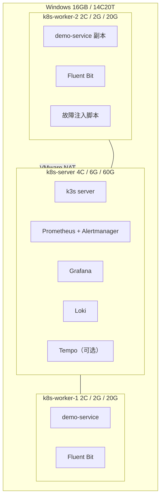

# 实验设计：16GB 宿主机 + VMware + k3s

> 宿主机：Windows，16 GB 内存，14 核 20 线程。
> 结论：可以搭三节点集群，但要用 k3s，并且严格分配内存。

## 0. 结论先行

- **不要用 kubeadm 跑三台 8G 虚拟机**，16GB 宿主机扛不住。
- 用 **k3s**：控制面更轻，单二进制，自带 containerd、CNI、local-path、metrics-server。
- 三台虚拟机内存分配 **6G + 2G + 2G = 10G**，给 Windows 留 6G。
- CPU 分配 **4 + 2 + 2 = 8 vCPU**，宿主机有 20 线程，足够。
- 监控栈全部放在 server 节点，业务 Pod 放两个 worker。
- 磁盘建议至少 100 GB 空闲，虚拟机用精简置备。

## 1. 资源预算

16GB 不是全部给虚拟机。实际分配要留出：

| 用途 | 预估 |
|---|---|
| Windows 系统 + 浏览器 + 编辑器 | 4～6 GB |
| VMware 自身开销 | 0.5～1 GB |
| 三台虚拟机 | 10 GB |
| 余量（防止 swap） | 1～2 GB |

**红线**：虚拟机总内存不要超过 11 GB。超过之后 Windows 会频繁换页，VMware 里的集群也会跟着卡。

### 虚拟机配置

| 主机名 | 角色 | vCPU | 内存 | 磁盘 | 跑什么 |
|---|---|---|---|---|---|
| `k8s-server` | k3s server | 4 | 6 GB | 60 GB | 控制面 + Prometheus + Grafana + Loki + Alertmanager |
| `k8s-worker-1` | k3s agent | 2 | 2 GB | 20 GB | demo 服务 + Fluent Bit |
| `k8s-worker-2` | k3s agent | 2 | 2 GB | 20 GB | demo 服务 + Fluent Bit + 故障注入 |

磁盘紧张时：60 / 20 / 20 = 100 GB；更紧张就 50 / 15 / 15 = 80 GB，但 Prometheus 和 Loki 的保留期要缩短。

## 2. 拓扑

## 3. 为什么是 k3s，不是 kubeadm

| 维度 | kubeadm | k3s | 16GB 下的选择 |
|---|---|---|---|
| 控制面内存 | 1.5～2 GB | 0.4～0.8 GB | k3s |
| 数据存储 | etcd | 默认 SQLite，可用 embedded etcd | k3s |
| 容器运行时 | 需自己装 containerd | 内置 | k3s |
| CNI | 需自己装 Calico/Flannel | 内置 Flannel | k3s |
| Ingress | 需自己装 | 内置 Traefik | k3s |
| 本地存储 | 需自己装 | 内置 local-path | k3s |
| 生产相似度 | 高 | 中 | 用概念对齐来弥补 |

k3s 不是「玩具」，它的 API、调度器、kubelet、CNI、RBAC 与标准 K8s 一致。你要练的链路和权限模型都能成立。区别主要在控制面组件和默认插件。

**如果坚持 kubeadm**：只能做两台虚拟机（server 7G + worker 4G = 11G），会失去「节点故障」这类实验，监控栈也会很挤。不建议作为第一版。

## 4. 组件与资源限制

所有组件都要写 `requests` / `limits`，否则调度器会把它们到处塞，2G 的 worker 很容易被压垮。

| 组件 | requests | limits | 说明 |
|---|---|---|---|
| Prometheus | 300Mi | 1.2Gi | 保留 7 天，抓取间隔 15s |
| Alertmanager | 64Mi | 128Mi | 单副本 |
| Grafana | 128Mi | 256Mi | 单副本 |
| Loki | 256Mi | 768Mi | 单机模式，文件系统存储，保留 5～7 天 |
| Tempo（可选） | 256Mi | 512Mi | 内存紧张时先不装 |
| OTel Collector | 128Mi | 256Mi | DaemonSet 或 Deployment |
| kube-state-metrics | 64Mi | 128Mi | 单副本 |
| node-exporter | 32Mi | 64Mi | 每节点一个 |
| Fluent Bit | 64Mi | 128Mi | 每节点一个 |
| demo-service | 64Mi | 192Mi | 两个副本 |
| AI 服务 | 128Mi | 512Mi | FastAPI，不含模型 |

粗略合计：server 节点约 2.5～3.5 GB，每个 worker 约 0.5～0.8 GB，都有余量。

## 5. 搭建顺序

### 阶段 0：三台虚拟机 + 系统基线

- 安装 Ubuntu Server 24.04 LTS。
- VMware 网络用 NAT，配置静态 IP（例如 `192.168.56.10/11/12`）。
- 设置 hostname、`/etc/hosts`、关闭 swap、时间同步。
- 确认三台机器能互相 ping 通。

**验收**：`hostname`、`ip addr`、`ping` 正常，`free -h` 看到预期内存。

### 阶段 1：k3s 集群

- server 节点执行 `k3s server` 安装，记录 token。
- 两个 worker 用 token 加入。
- 配置 kubeconfig 到宿主机或 server 节点。
- 确认 Traefik、local-path、metrics-server 正常。

**验收**：`kubectl get nodes` 三个 Ready；能部署 nginx 并通过 NodePort 访问。

### 阶段 2：指标链路

> 状态：已完成，验收记录见 [阶段 2 指标链路验收记录](02-phase-2-acceptance.md)。

- 安装 kube-prometheus-stack（或手动装 Prometheus + Grafana + kube-state-metrics）。
- 给所有组件设置资源限制。
- 导入 Node Exporter、K8s 集群、Pod 资源面板。
- 写 PromQL：节点 CPU、Pod 内存、容器重启次数。

**验收**：Grafana 能看到三台节点和 Pod 指标；删 Pod 后能看到重启计数变化。

### 阶段 3：日志链路

> 状态：已完成，验收记录见 [阶段 3 日志链路验收记录](03-phase-3-acceptance.md)；三台 VM 已有 `phase-3-logging-ready` 快照。

- 部署 Loki 单机模式，文件系统存储。
- 部署 Fluent Bit DaemonSet，采集 `/var/log/containers`。
- demo-service 输出 JSON 日志，字段包含 `level`、`service`、`trace_id`、`message`。
- Grafana 添加 Loki 数据源，用 LogQL 查询。

**验收**：能按 namespace / pod / level 过滤；能查到一条完整的多行异常堆栈。

### 阶段 4：链路追踪

> 状态：验收通过，见 [阶段 4 链路追踪验收记录](04-phase-4-acceptance.md)；三台 VM 已有 `phase-4-tracing-ready` 快照。

- 部署 Tempo 单机模式，文件系统存储 + `local-path` PVC。
- 部署 OTel Collector，接收 OTLP trace 并转发给 Tempo。
- demo-service 接入 OTel Python SDK，把 `trace_id`/`span_id` 写进 JSON 日志。
- Grafana 配置 Tempo 数据源、Loki derived field 和 `tracesToLogsV2`。

**验收**：能看到一次请求的完整 span 树；日志能跳到 Tempo，Tempo 也能反查同一 trace 的 Loki 日志。

### 阶段 5：告警与 SLO

- 定义 demo-service 的 SLI/SLO。
- 配置多窗口燃烧率告警。
- 配置 Alertmanager 路由、分组、抑制、静默。
- 接一个本地 webhook 或 IM 通知。

**验收**：能解释一次告警从规则到通知的完整路径。

### 阶段 6：AI 告警摘要

- FastAPI 接收 Alertmanager webhook。
- 查询 Prometheus 和 Loki，组装上下文。
- 裁剪、脱敏、控制 token。
- 调用 LLM，输出结构化 JSON：摘要、证据、候选原因、建议。

**验收**：注入故障后，输出至少两条能对上真实查询的证据。

### 阶段 7：受控运维

- 创建只读 ServiceAccount，验证越权被拒绝。
- 增加一个低风险动作（如 restart deployment），带 dry-run。
- 增加人工审批和审计日志。

**验收**：未审批不执行；越权被拒绝；审计能还原一次操作。

### 阶段 8：故障演练与复盘

- 删 Pod、CPU 压力、网络延迟、磁盘压力。
- 记录预期 vs 实际。
- 写 postmortem。

## 6. 内存不够时的降级顺序

按这个顺序砍，不要反过来：

1. 不装 Tempo / OTel Collector（先保住指标 + 日志）。
2. Prometheus 保留期从 7 天降到 3 天。
3. Loki 保留期降到 3 天，日志只留 error/warn。
4. 不装 Chaos Mesh，用脚本注入故障。
5. 退到单台 8G 虚拟机跑 k3s，放弃节点故障实验。

**永远不要砍**：日志链路、AI 摘要、RBAC 和审计。这三块是求职时最能讲的部分。

## 7. LLM 怎么接

16GB 宿主机不适合在虚拟机里跑本地大模型。三个选择：

| 方式 | 优点 | 注意 |
|---|---|---|
| 云端 OpenAI 兼容 API | 简单、效果好 | 日志要脱敏，用假数据练习 |
| 宿主机 Windows 跑 Ollama | 数据不出本机 | 会占 4～6 GB 内存，和虚拟机抢资源 |
| 公司/学校提供的模型网关 | 合规 | 确认网络可达 |

建议第一版用云端小模型，demo 日志全部用合成数据；等链路跑通后，再考虑 Ollama。

## 8. 磁盘规划

| 内容 | 预估 |
|---|---|
| Ubuntu Server | 8～10 GB |
| 容器镜像 | 10～20 GB |
| Prometheus 数据（7 天） | 5～10 GB |
| Loki 数据（7 天） | 5～10 GB |
| 系统日志和缓冲 | 5 GB |

虚拟机用**精简置备**，实际占用会小于分配值。宿主机至少留 100 GB 空闲。

## 9. 待确认

- 宿主机剩余磁盘有多少？
- 是否接受 k3s，还是坚持 kubeadm（只能两节点）？
- LLM 用云端 API 还是本机 Ollama？
