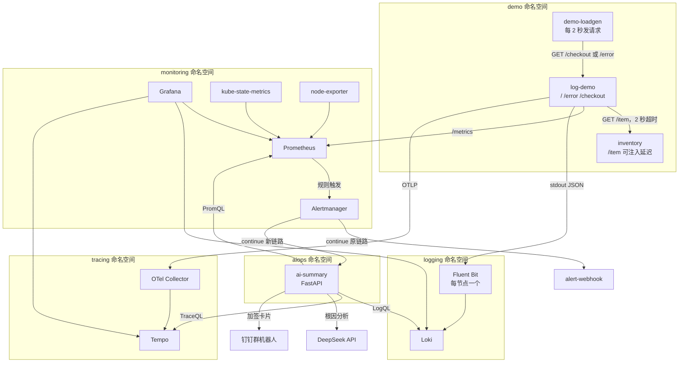
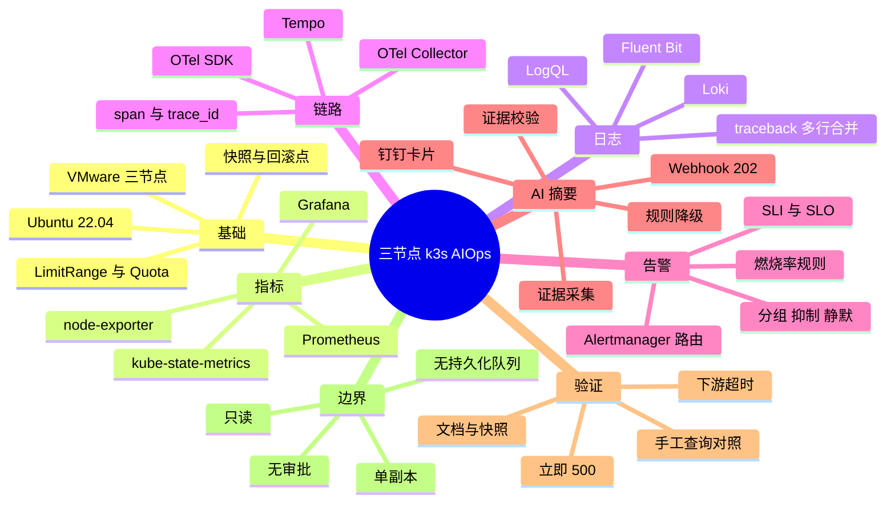
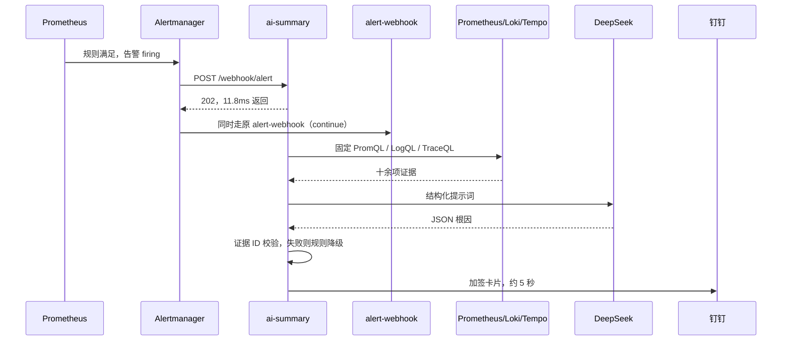

# 阶段 0–6 系统全景：结构、链路与面试复述

> 更新时间：2026-10-28
> 范围：阶段 0–6（集群底座、指标、日志、链路、告警、AI 摘要）
> 用途：一页看懂系统怎么搭、数据怎么流、故障怎么定位，并能按章节复述出来。
> 本文不含任何密钥。所有数字都能在验收文档里找到出处。

---

## 0. 先记住这张口诀卡

把整个项目压缩成六个数字：

| 数字 | 含义 | 一句话 |
|---|---|---|
| **1** | 一个集群 | 3 节点 k3s，跑在 16GB 宿主机上 |
| **3** | 三条数据链路 | 指标、日志、链路，各自独立又互相跳转 |
| **3** | 三个告警 | FastBurn、SlowBurn、NoTraffic |
| **1** | 一个 AI 服务 | 收告警、拉证据、调模型、发钉钉 |
| **2** | 两次真实验证 | 立即 500、下游超时 |
| **0** | 零写操作 | 只读诊断，不动集群 |

复述时先报这六个数字，再展开。面试官最容易记住结构，而不是组件名。

---

## 1. 系统一句话与边界

**一句话**：这是一个自建的 AIOps 实验平台，把「故障 → 告警 → 证据 → 结论」这条链路自动化到钉钉卡片，人只需要判断和执行。

**它做什么**：

- 采集指标、日志、链路三类可观测性数据
- 用 SLO 燃烧率判断“是否值得叫人”
- 告警触发后自动聚合证据，调用大模型生成根因分析
- 把结论推送到钉钉，包含证据、影响组件和建议动作

**它不做什么**：

- 不重启、不回滚、不扩缩容（阶段 7 才做）
- 不直接让模型生成 PromQL 或操作集群
- 不声称生产级：单副本、无鉴权、无持久化队列

这个边界要主动说。主动划边界，比被问出来强。

---

## 2. 全景结构图



### 2.1 如果图没渲染，看这张文字版

```text
demo
  demo-loadgen --GET--> log-demo --GET /item 2s timeout--> inventory
        log-demo --/metrics--> Prometheus
        log-demo --stdout--> Fluent Bit --> Loki
        log-demo --OTLP--> OTel Collector --> Tempo

monitoring
  Prometheus --rules--> Alertmanager
        Alertmanager --continue--> alert-webhook（原链路）
        Alertmanager --continue--> ai-summary（新链路）

aiops
  ai-summary --> Prometheus（PromQL）
            --> Loki（LogQL）
            --> Tempo（TraceQL）
            --> DeepSeek（生成根因）
            --> 钉钉（加签卡片）
```

### 2.2 命名空间分工

| 命名空间 | 放什么 | 为什么单独放 |
|---|---|---|
| `demo` | 被观测的业务和故障注入 | 故障不影响监控栈 |
| `monitoring` | Prometheus、Alertmanager、Grafana | 监控与被监控分离 |
| `logging` | Loki、Fluent Bit | 日志是节点级采集，需要独立权限 |
| `tracing` | Tempo、OTel Collector | 链路数据量和保留策略不同 |
| `aiops` | AI 摘要服务 | 可单独限制资源和网络 |

---

## 3. 思维导图



---

## 4. 四条数据链路

理解这个系统，关键是理解“一条数据从哪来、到哪去、为什么需要这一跳”。

### 4.1 指标链路

```text
应用 /metrics + kubelet + kube-state-metrics + node-exporter
        -> Prometheus 每 15–30 秒抓一次
        -> recording rule 预先算好 SLI 和燃烧率
        -> Grafana 展示 / Alertmanager 告警 / AI 服务查询
```

| 组件 | 为什么需要 |
|---|---|
| Prometheus | 拉模式时序库，负责抓取和计算 |
| recording rule | 把复杂 PromQL 预计算，保证人工查询和 AI 查询同一口径 |
| kube-state-metrics | 把 K8s 对象状态（重启、副本数）变成指标 |
| node-exporter | 节点级 CPU、内存、磁盘 |
| Grafana | 可视化与人工排查入口 |

关键点：**AI 不自己实现 SLO 公式，只读 recording rule 的结果**。这样卡片上的数字和 Grafana 里的数字不可能不一致。

### 4.2 日志链路

```text
应用 stdout 输出 JSON（level、message、trace_id、span_id）
        -> 节点上的 Fluent Bit 采集
        -> 补充 namespace / pod / node 标签
        -> Loki 存储
        -> Grafana LogQL 查询
```

| 组件 | 为什么需要 |
|---|---|
| Fluent Bit | DaemonSet，每节点一个，负责采集和打标签 |
| Loki | 只索引标签，不索引全文，省资源 |
| 多行合并 | Python traceback 默认一行一条，必须合并成一条 |

关键点：日志里带 `trace_id`，才能从日志跳到链路。这是日志和链路两条链路真正的连接点。

### 4.3 链路链路

```text
应用用 OTel SDK 创建 span
        -> OTLP 发给 OTel Collector
        -> Collector 批量导出到 Tempo
        -> Grafana 按 trace_id 查看 span 树
```

| 组件 | 为什么需要 |
|---|---|
| OTel SDK | 在代码里埋点，记录调用关系与耗时 |
| Collector | 解耦应用与后端，负责批处理、重试、导出 |
| Tempo | 按 trace_id 存储和检索链路 |

关键点：`inventory.call` 子 span 的时长是**调用方等待时长**。6b 里它是 2013ms，而 inventory 实际处理了 5000ms——这是后面讲 6b 的关键细节。

### 4.4 告警到 AI 的链路



关键点：

- **`continue: true`**：原通知链路不丢，AI 是旁路，不是替代。
- **先 202**：Alertmanager 的 webhook 有超时限制，模型调用可能十几秒，不能同步等。
- **固定查询**：不让模型生成 PromQL，避免查错、查慢、被日志里的指令带偏。
- **证据校验**：模型引用的 ID 必须真实存在，根因不能提证据里没有的组件。

---

## 5. 组件清单与资源

| 层 | 组件 | 版本 / 配置 | 资源 |
|---|---|---|---|
| 集群 | k3s | `v1.36.5+k3s1`，3 节点 | server 4C/6GB，worker 2C/3GB ×2 |
| 指标 | kube-prometheus-stack | `92.11.0` | Prometheus / Alertmanager 各 2 容器 |
| 日志 | Loki | chart `19.0.3`，应用 `3.7.9` | PVC 5Gi |
| 日志 | Fluent Bit | chart `0.58.3`，应用 `5.1.3` | 每节点一个 DaemonSet |
| 链路 | Tempo | chart `3.2.1`，应用 `3.1.1` | 单副本 |
| 链路 | OTel Collector | `0.163.2` | 单副本，36Mi |
| AI | ai-summary | FastAPI + uvicorn | 39Mi，limit 384Mi |
| 演示 | log-demo / loadgen / inventory | Python | 40Mi / 0Mi / 14Mi |
| 访问 | Grafana / Prometheus / Alertmanager | NodePort `30030 / 30090 / 30093` | — |

---

## 6. 关键数字

这张表是面试时的“弹药”。每个数字都能解释来源。

| 项 | 值 | 含义 |
|---|---|---|
| SLO | 99% | 错误预算 1%，燃烧率 = 错误率 / 1% |
| FastBurn | 5m/1h > 14.4，`for: 2m` | 快速失血 |
| SlowBurn | 30m/6h > 6，`for: 15m` | 慢性劣化 |
| NoTraffic | 10m 无请求 | 链路或探针中断 |
| 规则评估 | 30s | recording rule 和 alert rule 的间隔 |
| 告警延迟 | 约 11 分钟 | 窗口 + `for` + 评估间隔叠加，设计取舍 |
| Webhook 响应 | 11.8ms | 返回 202 的实测值 |
| 卡片延迟 | 约 5 秒 | 告警收到 → 钉钉收到（6b 实测） |
| 去重窗口 | 600s | 进程内去重 |
| 钉钉限流 | 10 条/60s 后转汇总 | 代码已实现，未压测 |
| 下游超时 | 2s | demo 调 inventory |
| 客户端超时 | 5s | loadgen 调 demo，必须大于下游超时 |
| Trace 采样 | 只取 2 条 | 控制 token 和延迟 |

---

## 7. 证据模型

AI 服务不只看一个指标，而是固定采集一组证据，每个证据有 ID。

| ID | 来源 | 查询 / 内容 | 用途 |
|---|---|---|---|
| M1 / M1h / M30m / M6h | Prometheus | 四个窗口的燃烧率 | 判断突发还是持续 |
| M2 | Prometheus | 5 分钟可用性 | 描述“掉到多少” |
| M3 | Prometheus | 5xx 比例 | 判断是否错误类故障 |
| M4 | Prometheus | 请求速率 | 识别无流量 |
| M5 | Prometheus | 错误路径 + 状态码 + 速率 | 定位是哪个接口 |
| M6 | Prometheus | P95 延迟 | 判断是否变慢 |
| M7 | Prometheus | target `up` 与 Pod 名 | 确认实例是否存活 |
| L1 / L1_COUNT | Loki | 错误日志样本与条数 | 拿到具体错误文本 |
| T1 | Tempo | 错误 trace 与错误 span 数 | 确认链路异常 |
| T2 | Tempo | `inventory.call` 子 span 时长 | 定位下游慢 |

### 7.1 为什么要多源

单一证据会误判：

- 只有错误率 → 不知道是哪个接口、什么错误
- 只有日志 → 可能是噪音，不能证明影响面
- 只有链路 → 只知道慢，不知道错误率是否真的超阈值

三个源交叉，才能从“系统在烧”走到“哪个接口、什么现象、慢在哪里”。

### 7.2 服务端校验规则

1. 模型返回的每个证据 ID 必须存在于采集结果中，不存在就丢弃。
2. 根因里出现证据未覆盖的组件（如 6a 里的 `inventory`、数据库、Redis），判定不合格。
3. 模型不可用、超时、返回非法 JSON 时，走规则降级模板。
4. 卡片里的优先级由服务端规则计算，不采信模型自报。

---

## 8. 两次故障：从现象到结论

### 8.1 6a：接口立即 500

```text
时间线（2026-10-26）
20:15:31  注入 TARGET_PATH=/error
20:26:49  FastBurn active
20:26:52  模型返回，引用 M3/M5/M2/L1/T1
20:26:54  钉钉 P1 卡片
20:35:49  resolved
```

证据：

```text
M1=100  M3=1  M5=/error 500 0.498/s  M6=0.00475s  L1=149 行
```

结论：

> `/error` 路径 100% 返回 500，日志持续报错，trace 有错误 span；但证据没有揭示 500 的具体触发原因。

这是**正确的“不知道”**。模型没有编造数据库或下游。

### 8.2 6b：下游超时

```text
时间线（2026-10-28）
15:00:51  切 /checkout，inventory 延迟 5000ms
15:11:09  FastBurn startsAt
15:11:19  ai-summary 收到告警
15:11:24  钉钉 P1 卡片
15:22:49  resolved
```

证据：

```text
M1=100  M3=1  M5=/checkout 504 0.249/s  M6=2.425s  T2=2013ms  L1=75 行
```

结论：

> 调用下游 inventory 超时（trace 约 2013ms），导致 `/checkout` 返回 504，错误率 100%。

### 8.3 两次对比

| 项 | 6a | 6b |
|---|---|---|
| 故障 | 自身立即失败 | 下游变慢 |
| 路径 / 状态 | `/error` 500 | `/checkout` 504 |
| P95 | 4.75ms | 2425ms |
| T2 | 无 | 2013ms |
| 日志 | `demo error for Loki` | `downstream timeout` |
| 根因 | 自身 500，原因未知 | 下游超时 |
| 证据 | M2/M3/M5/L1/T1 | M3/M5/L1/T1/T2 |

**这张对比表是整个项目最有说服力的部分**：同一套采集和提示词，面对两种故障给出了不同结论。

### 8.4 排障时的思考顺序

如果面试官问“拿到告警你先看什么”，按这个顺序答：

1. **先看影响面**：M1/M3——错误率多少，是否真的超过阈值。
2. **再看路径**：M5——哪个接口、什么状态码。
3. **再看现象**：M6 + L1——是变慢还是报错，日志说什么。
4. **最后看调用链**：T1/T2——如果有下游，慢在哪个 span。
5. **证据不齐就停**：明确说“证据不足”，不猜。

---

## 9. 怎么复述

### 9.1 30 秒版

> 这是一个三节点的 k3s 实验平台。我搭了指标、日志、链路三条可观测性链路，在上面做了基于燃烧率的 SLO 告警。然后用 FastAPI 写了一个 AI 摘要服务：收到告警后自动拉三类证据，调用 DeepSeek 生成根因分析，服务端校验证据后再推送到钉钉。最后用两种真实故障验证过——接口立即 500 和下游超时，卡片给出的结论不一样。

### 9.2 3 分钟版（五段）

**第一段：为什么做（20 秒）**

> 告警只会告诉我“SLO 在烧”，不会告诉我“为什么烧、先查哪”。我想把排障第一步的证据收集自动化，所以做了这个项目。

**第二段：搭了什么（40 秒）**

> 三节点 k3s，16GB 宿主机，单节点 2C/3GB。指标用 Prometheus + Grafana，日志用 Fluent Bit + Loki，链路用 OTel Collector + Tempo。三条链路各自独立，但通过 trace_id 和标签能互相跳转。

**第三段：告警怎么设计（40 秒）**

> demo 服务定 99% 可用性 SLO。用多窗口燃烧率：5 分钟和 1 小时都超过 14.4 倍触发 FastBurn，30 分钟和 6 小时超过 6 倍触发 SlowBurn，另外有 NoTraffic。Alertmanager 用 `continue: true`，原通知链路保留，同时旁路一份给 AI 服务。

**第四段：AI 服务怎么工作（50 秒）**

> Webhook 先返回 202，后台处理，11.8 毫秒，不阻塞 Alertmanager。然后按固定查询拉十项证据：燃烧率、错误率、错误路径、P95、日志、trace。提示词里把证据按 ID 编号，模型只做归纳。返回后用服务端校验：引用的 ID 必须存在，根因不能提证据里没有的组件；模型失败就走规则模板。最后加签推钉钉，告警收到到卡片大约 5 秒。

**第五段：怎么证明有效（30 秒）**

> 两次真实故障。一次是 `/error` 立即 500，卡片说“自身 500、触发原因证据不足”；一次是 `/checkout` 调 inventory 超时，卡片说“下游超时导致 504”。两次证据不同、结论不同，关键数值和手工 PromQL 逐项对得上。

**收尾（10 秒）**

> 目前是只读诊断，不执行任何写操作。下一阶段做受控运维：只读权限、动作白名单、dry-run、人工审批和审计。

### 9.3 白板画法

如果让你现场画，按这个顺序，30 秒能画完：

1. 画三个框：`demo`、`monitoring`、`aiops`。
2. demo 里画三个方块：loadgen → log-demo → inventory。
3. 从 log-demo 拉三条线出去：`/metrics` 到 Prometheus、stdout 到 Fluent Bit、OTLP 到 Collector。
4. 在 monitoring 里写 Prometheus → Alertmanager。
5. 从 Alertmanager 画两条分叉：一条回原 webhook，一条到 ai-summary，标 `continue`。
6. 从 ai-summary 画三条查询线回 Prometheus / Loki / Tempo，再画两条外部线到 DeepSeek 和钉钉。
7. 在角上写六个数字：1 集群、3 链路、3 告警、1 服务、2 验证、0 写操作。

---

## 10. 面试视角

### 10.1 开场怎么说

不要一上来报组件名。先给一句定位，再给结构：

> 这是一个个人实验项目，目标是把 SLO 告警之后的证据收集和初步归因自动化。规模不大，三节点，但每一层都是我亲手搭的，所以每一跳为什么存在我都能解释。

“每一跳为什么存在”这句话很重要，它把话题从“你用过什么”转到“你理解什么”。

### 10.2 讲项目的结构

按这个顺序讲，不要按时间顺序讲：

1. **问题**：告警只说结果，不说原因。
2. **约束**：16GB、3 节点、单节点 3GB，所以要做取舍。
3. **方案**：三条数据链路 + 旁路 AI 服务。
4. **关键设计**：202 异步、固定查询、证据校验、规则降级。
5. **验证**：两类故障、数字对齐。
6. **边界**：只读、单副本、下一步。

### 10.3 高频追问

| 问题 | 回答要点 |
|---|---|
| 为什么告警要 11 分钟才来？ | 5m 窗口要积累、1h 窗口也要超阈值、`for: 2m`、30s 评估间隔叠加。这是为了避免抖动误报，代价是发现慢；生产可以加更短窗口或提高评估频率。 |
| 为什么 Webhook 先返回 202？ | Alertmanager 的 webhook 有超时，模型调用十几秒会阻塞甚至触发重试。先 202，后台处理；代价是 Pod 重启会丢任务，生产要加队列。 |
| 为什么不让模型自己生成 PromQL？ | 三个原因：可能查错、可能查慢、可能被日志里的指令带偏。固定查询 + recording rule 保证口径一致、结果可复现。 |
| 怎么防止模型胡说？ | 证据 ID 必须真实存在；根因不能出现证据未覆盖的组件；模型失败或 JSON 非法时走规则模板；优先级由服务端算。 |
| 为什么只取 2 条 trace？ | 摘要只需要判断“有没有错、慢在哪”，不需要全量统计；trace 详情可能几十个 span，token 和延迟都会上去。代价是不能得出比例结论。 |
| 6a 和 6b 怎么区分？ | M5 的路径和状态码不同，M6 从 4.75ms 变成 2425ms，6b 多了 T2 子 span 和 `downstream timeout` 日志。服务端有超时场景判断，不会套同一套模板。 |
| 为什么单副本？ | 实验环境取舍。生产要多副本 + 共享去重 + 持久化队列，否则重启丢告警、去重失效。 |
| 为什么不用 RAG？ | 这里的问题是“这次故障发生了什么”，答案在时间窗内的结构化数据里，不需要向量检索。RAG 更适合查 runbook 和历史事故，可以作为下一步。 |
| 最难的问题是什么？ | 三个：traceback 多行合并、Loki 双重 JSON 解包、客户端超时等于下游超时导致 BrokenPipe。每个都说清“现象 → 定位 → 修复”。 |
| 如果上生产要改什么？ | 预构建镜像、消息队列、鉴权、Ingress/TLS、多副本、持久化审计、限流压测。 |
| 阶段 7 打算怎么做？ | 只读 ServiceAccount + 动作白名单 + dry-run + 人工审批 + 审计日志，模型只建议不执行。 |
| 为什么不用现成 AIOps 平台？ | 自建是为了看清每一跳；商用平台把证据链封装了，出问题只能猜。这个项目的目的就是能解释每一个数字从哪来。 |

### 10.4 不要说的话

| 别说 | 原因 |
|---|---|
| “生产级”“高可用” | 单副本、无鉴权、无队列，一问就穿 |
| “自动修复”“自动运维” | 现在零写操作 |
| “降低 MTTR 30%” | 没有基线，无法证明 |
| “基于 RAG” | 实际是结构化证据注入，不是向量检索 |
| “支撑高并发” | 实验流量约 0.5 req/s |
| “我们团队” | 个人项目就说是个人项目，反而加分 |

### 10.5 部署问题、备用方案与动机的追问预备

面试官常见的一串问题是：部署遇到什么问题、怎么发现、怎么解决、以后还会遇到吗、有备用方案吗、对生产有什么帮助、为什么做这个项目。

#### 10.5.1 部署遇到过什么问题（按"现象 → 发现 → 定位 → 修复"讲）

| 问题 | 发现 | 定位 | 修复 | 经验 |
|---|---|---|---|---|
| Grafana OOMKilled | Pod 反复重启，`describe pod` 看 `Last State` | Grafana 13.2.4 加载 56 个插件，limit 只有 256Mi | 提到 512Mi，RESTARTS 归零 | 换版本要重估内存 |
| Tempo 安装失败 | `helm upgrade` 报 connection reset，报错在下载阶段 | 不是集群问题，是 GitHub Releases 不可达 | Windows 下载同官方 chart，SHA256 校验，核对 Chart.yaml，本地安装 | 离线产物要校验 |
| Collector exporter 弃用 | collector 日志 warning | 0.163.2 中 `otlp` exporter 是兼容别名 | exporter 改 `otlp_grpc`，receiver 不动 | 锁版本要读 changelog，变更要隔离 |
| startupProbe 被杀 | `RESTARTS=2`，日志停在 `pip install` | 预算 150s 小于清华源最慢安装时间 | `failureThreshold` 30→60（300s）；根治靠预构建镜像 | 探针预算按最慢可能值定 |

讲述时不要平均用力：①② 展示"怎么发现"，④ 展示"预防"，③ 顺路展示变更是隔离的。

#### 10.5.2 后续还会遇到吗？可以预防吗？

| 类型 | 预防 | 性质 |
|---|---|---|
| 环境依赖类（网络、安装） | 预构建镜像、chart 本地缓存 + SHA256、快照回滚 | 可根治 |
| 集成细节类（钉钉渲染、LLM 漂移、probe 预算） | 修复写成可复跑验证命令，加进验收清单；改 ConfigMap 必须 rollout restart | 以后可能再出现，出现时快速确认 |

配套动作：ai-summary 有 `/metrics` 自监控；每次修复同步登记 QA，改代码和快照双向回滚。

#### 10.5.3 有备用方案吗？需要准备吗？

按爆炸半径排序，逐个回答"什么时候切、谁来切"：

| 单点 | 主方案 | 备用 | 状态 |
|---|---|---|---|
| 通知 | 钉钉加签 | `continue` 双路到 alert-webhook + 邮件 webhook 已预留 | 邮件未启用 |
| LLM | DeepSeek | 规则降级模板已实现，接口 OpenAI 兼容可换 provider | 已做 |
| 安装/网络 | GitHub / Docker Hub | chart 离线缓存 + SHA256 + 镜像加速 | 已做 |
| 数据源 | Loki / Tempo 单副本 | 无 | 实验取舍，已写进已知偏差 |

#### 10.5.4 对接手生产工作的帮助与边界

帮助：会读别人的 values 并能说出每个字段的影响面；排障按 SLO → 三类证据的固定顺序；变更呼应"先基线再动手"的纪律；清楚 AI 权力要收到服务端校验里。

边界（主动说）：没有真实 on-call、容量规划、多团队协作经验；故障合成、流量自造。项目把"能直接接手什么"和"需要带入什么"划清了。

#### 10.5.5 为什么要做这个项目

> 网上教程教"怎么装"，没人回答"为什么每一跳存在"。我给自己定的验收是：能画出一条数据从产生到被 AI 使用，并解释每一跳为什么存在。
> 同时这是对"AI 进运维"边界的一次完整练习：结论必须挂证据、数字用手工查询对得上、模型失效有兜底。
> 坦白说这是个人实验：故障合成、流量自造，但问题来自真实场景，方法用的是生产方法。

### 10.6 可以反问面试官

面试最后通常会给你提问机会。这三个问题能显示你在意的是工程而不是工具：

1. 团队现在的 SLO 是怎么定的，告警噪音怎么治理？
2. AI 在运维场景落地时，最大的阻力是模型效果还是流程和权限？
3. 如果要做受控执行，审批粒度一般做到什么程度？

---

## 11. 术语表

| 术语 | 解释 |
|---|---|
| SLI | 服务质量指标，例如可用性、延迟 |
| SLO | 对 SLI 的目标，例如 99% 可用性 |
| 错误预算 | `1 - SLO`，本项目是 1% |
| 燃烧率 | 错误率 / 错误预算，14.4 倍表示 1 小时消耗约 2% 的 30 天预算 |
| Recording rule | Prometheus 预计算规则，保证口径一致 |
| FastBurn / SlowBurn | 短窗口快速失血 / 长窗口慢性劣化 |
| `continue: true` | Alertmanager 路由继续匹配下一条，实现旁路 |
| 抑制（inhibit） | critical 存在时压掉同服务的 warning |
| 静默（silence） | 指定时间内不发送某类告警 |
| Trace / Span | 一次请求的调用树 / 树上的一个节点 |
| OTLP | OpenTelemetry 的传输协议 |
| 降级 | 模型不可用时改用规则模板输出 |

---

## 12. 文件索引

| 内容 | 文件 |
|---|---|
| 实验设计 | [00-lab-design.md](00-lab-design.md) |
| 已实现能力总览 | [10-implemented-capabilities.md](10-implemented-capabilities.md) |
| 阶段 0–1 验收 | [01-phase-0-1-acceptance.md](01-phase-0-1-acceptance.md) |
| 阶段 2 指标 | [02-phase-2-acceptance.md](02-phase-2-acceptance.md) |
| 阶段 3 日志 | [03-phase-3-acceptance.md](03-phase-3-acceptance.md) |
| 阶段 4 链路 | [04-phase-4-acceptance.md](04-phase-4-acceptance.md) |
| 阶段 5 告警 | [06-phase-5-acceptance.md](06-phase-5-acceptance.md) |
| 阶段 6 AI 摘要 | [08-phase-6-acceptance.md](08-phase-6-acceptance.md) |
| AI 摘要原理 | [09-ai-summary-explained.md](09-ai-summary-explained.md) |
| 每日问答 | [../03-qa/00-qa-log.md](../03-qa/00-qa-log.md) |
| 集群清单 | [../../infra/](../../infra) |

---

## 13. 最后：三句话版本

如果只有 15 秒：

> 我搭了一个三节点 k3s 可观测性平台，做了 SLO 告警和一个 AI 摘要服务。它能在告警后自动收集指标、日志、链路证据，生成根因分析发到钉钉。我用两种真实故障验证过，它给出的结论不一样，而且每个数字都能用手工查询复现。
